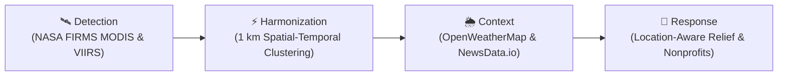
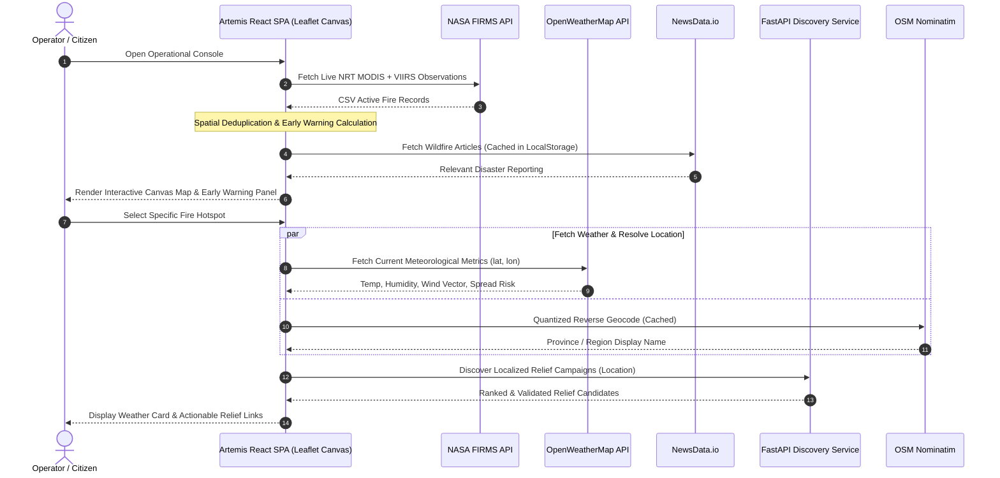

# Artemis — Satellite Fire Intelligence & Early Warning System

[](https://www.spaceappschallenge.org/)
[](.github/workflows/ci.yml)
[](https://www.typescriptlang.org/)
[](https://react.dev/)
[](https://fastapi.tiangolo.com/)
[](LICENSE)

> A high-performance, location-aware wildfire intelligence dashboard combining live NASA satellite observations, local fire-weather context, verified reporting, and direct relief access.

---

## 🎯 Overview & Triage Pipeline

When active wildfires occur, frontline responders, researchers, and affected citizens often face fragmented information. Satellite observations lack local weather context, news reports lack geospatial precision, and humanitarian relief options are scattered.

Artemis connects these silos into a single operational triage pipeline:



1. **Detection:** Collect near-real-time (NRT) active-fire observations from NASA FIRMS across MODIS and VIIRS (NOAA-21 & Suomi NPP).
2. **Harmonization:** Reduce cross-sensor duplication using spatial-temporal grid clustering (~1 km cell window) to produce an accurate, unified early-warning signal.
3. **Context:** Click any hotspot on the GPU-accelerated Leaflet canvas map to inspect immediate meteorological factors (wind speed, wind direction, humidity, temperature, and High Fire Spread Risk indicators).
4. **Response:** Automatically forward and reverse-geocode disaster coordinates to surface verified local wildfire campaigns (e.g., Kitabisa, Rumah Zakat) and global nonprofit relief (Every.org).

---

## 🏗️ Architecture & Data Flow



---

## 🚀 Key Features

### 1. Multi-Sensor Satellite Harmonization
- **Sensors:** MODIS Collection 6.1 (1 km resolution) combined with VIIRS NOAA-21 and Suomi NPP (375 m resolution).
- **Spatial Fusion:** Resolves duplicate detections within ~1 km grid cells, summing Fire Radiative Power (FRP, MW), calculating weighted brightness, and preserving peak confidence.
- **Layer Controls:** Toggle MODIS Raw, VIIRS Raw, and Harmonized layers independently to evaluate sensor discrepancies.

### 2. High-Performance Canvas Map
- Built with **Leaflet** optimized using an HTML5 Canvas Renderer (`L.canvas()`).
- Renders hundreds to thousands of active hotspots smoothly at 60 FPS without DOM thrashing.
- Region bounds overlays and quick-navigation across world continents and fire-prone countries.

### 3. Immediate Fire-Weather Context
- Inspect local meteorological data directly from **OpenWeatherMap** at hotspot coordinates.
- **High Fire Spread Risk Indicator:** Automatically flagged when wind speed $\ge 8\text{ m/s}$ and relative humidity $\le 35\%$.
- Includes loading skeletons, graceful abort controllers, and retry mechanics.

### 4. Wildfire Intelligence & Reporting
- Environment-focused news monitoring via **NewsData.io** in Indonesian and English (`karhutla`, `kebakaran hutan`, `wildfire`).
- Client-side deduplication, regex validation, and 30-minute local caching.

### 5. Verified Relief & Automated Campaign Discovery
- Location-matched donation links for verified disaster campaigns.
- Direct links to **Kitabisa** and **Rumah Zakat** relief funds, alongside global nonprofit access powered by **Every.org**.
- Standalone **FastAPI Discovery Service** with concurrent verification (`asyncio.gather`), HTML validation, and in-memory TTL caching.

---

## 🛠️ Technology Stack

| Layer | Technologies |
|---|---|
| **Frontend** | React 18, TypeScript 5.5, Vite 5, Tailwind CSS, Leaflet 1.9, Lucide Icons |
| **Backend Service** | Python 3.11, FastAPI, HTTPX, Uvicorn, ElementTree |
| **APIs Integrated** | NASA FIRMS NRT, OpenWeatherMap, NewsData.io, OSM Nominatim, Every.org |
| **Testing & Quality** | Vitest, ESLint 9, TypeScript strict mode, GitHub Actions CI |
| **DevOps** | Docker, Docker Compose, Nginx Alpine |

---

## 🏁 Quickstart

### Option A: Using Docker Compose (Recommended)

Run both the frontend and the FastAPI discovery service with a single command:

```bash
docker compose up --build
```

- **Frontend:** Accessible at `http://localhost:3000`
- **FastAPI Discovery Service:** Accessible at `http://localhost:8000/docs`

---

### Option B: Local Development

#### 1. Prerequisites
- **Node.js** 18+ and **npm**
- **Python** 3.11+ (optional, for the donation discovery service)

#### 2. Frontend Setup
```bash
# Install dependencies
npm install

# Configure environment variables
cp .env.example .env
```

Fill in your API keys in `.env`:
```env
VITE_CARTO_API_KEY=
VITE_FIRMS_API_KEY=your_nasa_firms_map_key
VITE_OPENWEATHER_API_KEY=your_openweathermap_api_key
VITE_NEWSDATA_API_KEY=your_newsdata_api_key
VITE_EVERY_ORG_API_KEY=your_every_org_api_key
VITE_DONATION_DISCOVERY_URL=http://localhost:8000
```

Start the Vite development server:
```bash
npm run dev
```

#### 3. Discovery Service Setup (Optional)
```bash
cd services/donation-discovery
python -m venv .venv

# Windows:
.venv\Scripts\activate
# Linux/macOS:
# source .venv/bin/activate

pip install -r requirements.txt
uvicorn app.main:app --reload --port 8000
```

---

## 🧪 Testing & Code Quality

Artemis includes automated test suites powered by **Vitest** for spatial harmonization, data parsing, and coordinate math.

```bash
# Run unit tests
npm test

# Run tests in watch mode
npm run test:watch

# Typecheck TypeScript codebase
npm run typecheck

# Run linter
npm run lint

# Build production bundle
npm run build
```

---

## 📁 Repository Structure

```text
.
├── .github/workflows/ci.yml       # Automated CI pipeline
├── public/                         # Public static assets & favicon
├── services/
│   └── donation-discovery/
│       ├── app/main.py             # FastAPI discovery and validation engine
│       ├── Dockerfile              # Container definition for backend
│       └── requirements.txt        # Python dependencies
├── src/
│   ├── components/                 # React UI components
│   │   ├── AboutModal.tsx          # Hackathon & mission info modal
│   │   ├── ArtemisLanding.tsx      # Welcome landing screen
│   │   ├── DonationCard.tsx        # Relief campaign item card
│   │   ├── DonationWidget.tsx      # Location-aware donation widget
│   │   ├── FireMap.tsx             # GPU-accelerated Leaflet canvas map
│   │   ├── LiveEarlyWarningPanel.tsx # Early warning triage signal
│   │   ├── NewsSlider.tsx          # Wildfire news slider with cache
│   │   ├── RegionSelector.tsx      # Global / regional focus selector
│   │   ├── SatelliteComparison.tsx # MODIS vs VIIRS sensor comparison
│   │   └── WeatherInfoCard.tsx     # Hotspot weather & fire risk card
│   ├── data/                       # Operational data sources & adapters
│   │   ├── donationApi.ts          # Relief campaigns & Every.org adapter
│   │   ├── firmsApi.ts             # NASA FIRMS parsing & spatial fusion
│   │   ├── locationApi.ts          # Nominatim forward/reverse geocoding
│   │   ├── newsDataApi.ts          # NewsData.io integration
│   │   ├── regions.ts              # Region geometries and bounds
│   │   ├── weatherApi.ts           # OpenWeatherMap client
│   │   └── __tests__/              # Vitest automated test suites
│   ├── types/index.ts              # Core domain type definitions
│   ├── App.tsx                     # Main console container
│   └── main.tsx                    # React application entry point
├── docker-compose.yml              # Multi-container orchestration
├── Dockerfile                      # Multi-stage production Dockerfile
├── LICENSE                         # MIT License
└── vite.config.ts                  # Vite build configuration
```

---

## 👥 Contributors

**Team:** ITS Surabaya — Institut Teknologi Sepuluh Nopember, Indonesia

| Contributor | Handle | Role |
|---|---|---|
| **Fadhil Mauludi** | `@fadhilm` | Team Lead & Architecture |
| **Ellvis Cornelius Setiawan** | `@ellviscs` | Contributor |
| **Desanda Verdely Yulisar** | `@mrpupperfish` | Contributor |
| **Evan Dakara Sukatrilaksana** | `@evandakara` | Contributor |
| **Jonathan Itung** | `@jonathanitung` | Contributor |
| **Muhammad Syamfiraas Akbar** | `@firz` | Contributor |

**Event:** [NASA Space Apps Challenge 2026](https://www.spaceappschallenge.org/)

---

## 📜 Disclaimer & License

- Artemis is an observational information and triage prototype. Satellite detections represent active heat anomalies and do not constitute official evacuation instructions or wildfire spread simulations. 
- Codebase licensed under the [MIT License](LICENSE).
